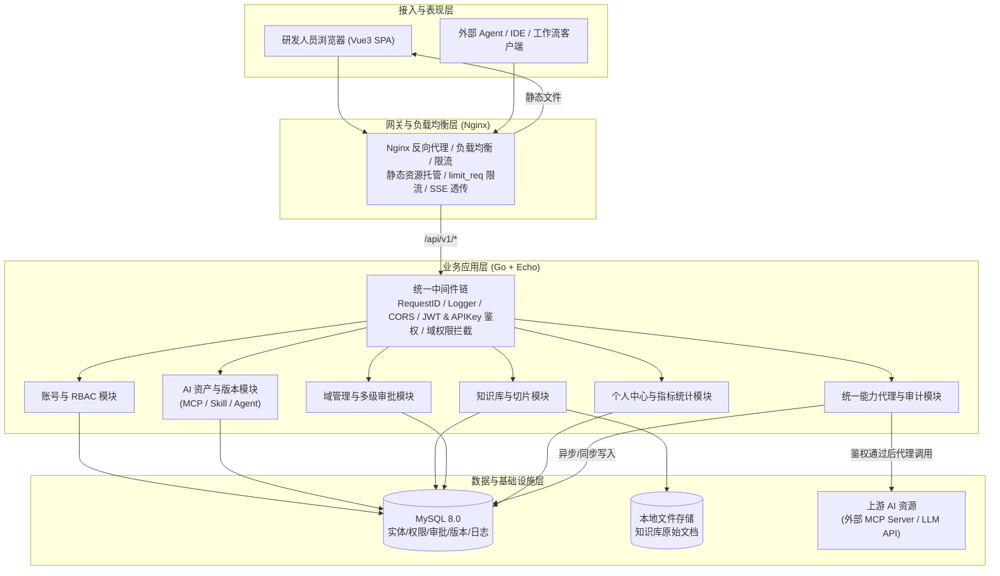
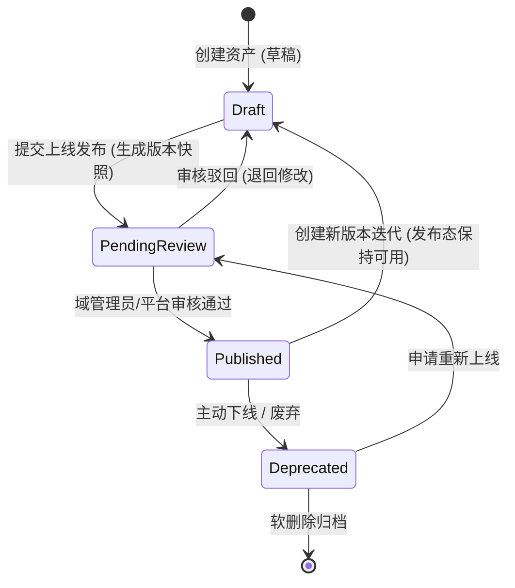
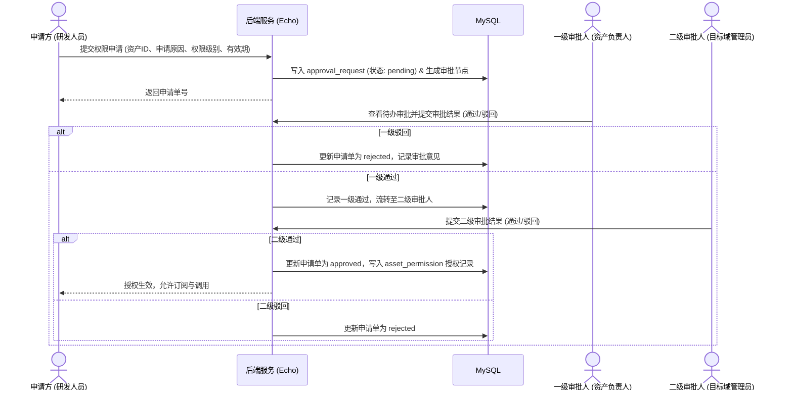
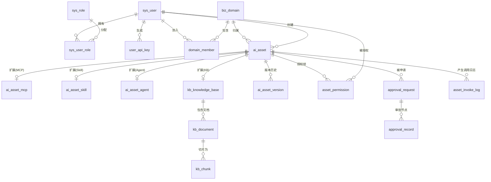
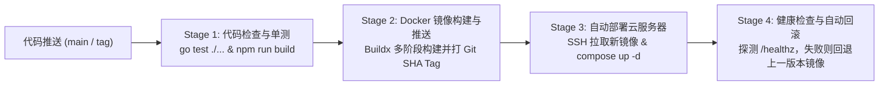

# AI 能力共享平台（ASCP）系统设计方案

> 本文档基于 [base-需求.txt](file:///C:/Users/12907/Desktop/cur/docs/毕业设计/AI_Capability_Sharing_Platform/docs/base-需求.txt) 编写，面向研发团队的多 Agent 协同开发场景，提供从总体架构、数据建模、核心业务流、前后端工程设计到 Nginx 网关、Docker 容器化与 CI/CD 流水线的完整系统设计方案，可作为毕业设计开题报告与后续工程实现的核心依据。

---

## 1. 项目概述与建设目标

### 1.1 建设背景与痛点

在多 Agent 与自动化工作流协同开发的研发场景中，团队内部通常会复用大量底层 AI 基础设施（MCP 服务、Skills 技能集、自定义 Agent 实例、私有知识库等）。若由各业务项目独立维护，会产生以下问题：

- **重复建设与版本割裂**：同一 MCP 工具或 Prompt/Skill 被多处复制，更新无法同步，线上行为不一致。
- **权限管控与安全审计缺失**：缺乏组织域隔离与调用鉴权，敏感知识库和内部服务存在越权调用风险，且调用过程不可追溯。
- **资产难以沉淀与度量**：缺少统一的能力检索、发布审批与订阅入口，无法统计各 AI 资产的实际调用量、成功率与性能指标。

### 1.2 建设目标

设计并实现前后端分离的 **AI 能力共享平台（AI Capability Sharing Platform，简称 ASCP）**：

1. **四类核心 AI 资产统一托管**：支持 MCP 服务、Skills 技能、Agent 实例、私有知识库的标准化录入、版本快照管理与上下线发布。
2. **域隔离与多级审批治理**：以业务域（Domain）为边界实现资源隔离，配套“能力申请 → 多级审批 → 授权生效 → 调用拦截 → 权限回收”的数字化闭环。
3. **统一调用入口与可观测性**：提供能力广场检索、订阅授权、API Key / JWT 统一代理调用与全链路调用日志审计、用量指标统计。
4. **工程化交付与自动化运维**：基于 Docker Compose 实现本地一键拉起，通过 Nginx 实现反向代理与负载均衡，并建设可回滚的 CI/CD 流水线。

---

## 2. 总体架构设计

### 2.1 系统分层架构



### 2.2 技术栈选型

| 层次 | 技术选型 | 选型说明 |
| :--- | :--- | :--- |
| **后端框架** | Go 1.22+ / Echo v4 | 高并发、路由性能优异、中间件生态完善，适合 API 服务与代理网关开发 |
| **ORM 与数据访问** | GORM + MySQL 驱动 | 支持事务控制、关联建模与自动迁移，兼顾开发效率与可维护性 |
| **日志与配置** | Zap + Viper | 结构化 JSON 日志输出；支持 YAML/环境变量多环境配置切换 |
| **前端框架** | Vue 3 (Composition API) + TypeScript + Vite | 现代化响应式前端栈，类型安全，构建速度快 |
| **前端生态** | Vue Router + Pinia + Element Plus + Axios + ECharts | 完整覆盖后台管理布局、状态管理、权限路由与调用统计可视化图表 |
| **反向代理** | Nginx | 静态资源托管、后端多实例负载均衡（`upstream`）、请求限流（`limit_req`）、SSE 流式透传 |
| **持久化存储** | MySQL 8.0 | 存储核心业务实体、RBAC 权限、审批流、版本快照、知识库切片与调用审计日志 |
| **容器与 CI/CD** | Docker + Docker Compose + GitHub Actions | 统一开发/生产环境镜像，实现自动测试、构建推送与服务器部署回滚 |

### 2.3 工程目录结构规划

结合仓库现有目录结构（`docker/`、`docs/`、`src/backend/`、`src/frontend/`、`src/nginx/`），规划如下工程目录：

```text
AI_Capability_Sharing_Platform/
├── docs/                               # 设计文档、需求文档、开题与接口文档
│   ├── base-需求.txt
│   └── 系统设计方案.md
├── docker/                             # 容器化编排与 Dockerfile
│   ├── backend.Dockerfile
│   ├── frontend.Dockerfile
│   ├── docker-compose.dev.yml          # 本地开发环境一键拉起
│   └── docker-compose.prod.yml         # 生产环境部署编排
├── src/
│   ├── nginx/
│   │   ├── ASCP_nginx.conf.example     # Nginx 配置模板
│   │   └── ASCP_nginx.conf             # 实际生效配置（或由环境模板生成）
│   ├── backend/                        # Go Echo 后端工程
│   │   ├── cmd/server/main.go          # 程序入口
│   │   ├── config/                     # 配置加载与 config.yaml
│   │   ├── internal/
│   │   │   ├── handler/                # Echo HTTP 控制器层
│   │   │   ├── service/                # 核心业务逻辑层
│   │   │   ├── repository/             # MySQL 数据访问层
│   │   │   ├── model/                  # 数据库实体与 DTO
│   │   │   ├── middleware/             # JWT、APIKey、域鉴权、日志中间件
│   │   │   └── pkg/                    # 加密、切片器、MCP探测、统一响应封装
│   │   ├── migrations/                 # SQL 初始化与版本迁移脚本
│   │   ├── go.mod
│   │   └── go.sum
│   └── frontend/                       # Vue3 前端工程
│       ├── src/
│       │   ├── api/                    # Axios 封装与各模块 API
│       │   ├── router/                 # 路由与权限守卫
│       │   ├── stores/                 # Pinia 状态管理
│       │   ├── views/                  # 页面视图（广场/资产/知识库/域与审批/个人中心）
│       │   ├── components/             # 公共业务组件
│       │   └── main.ts
│       ├── package.json
│       └── vite.config.ts
└── .github/workflows/ci-cd.yml         # CI/CD 流水线配置
```

---

## 3. 核心业务流程与状态机设计

### 3.1 AI 资产全生命周期状态机

四类核心资产（MCP 服务、Skills 技能、Agent 实例、私有知识库）统一采用标准化生命周期状态机管理：



- **版本快照机制**：每次从 `Draft` 提交发布时，自动将当前资产的元信息与核心配置（如 MCP Endpoint、Skill Schema、Agent 编排关系）序列化存入版本记录表，支持历史版本查看与一键回滚。

### 3.2 域管理与多级审批流程

当用户需要访问**非本人创建**且**非公开**的域内/跨域受控资产时，需发起权限申请并经过多级审批：



### 3.3 统一调用鉴权拦截链路

所有对受托管资产（MCP 代理调用、Skill 执行/获取、Agent 对话、知识库检索）的请求均经过统一鉴权拦截器：

1. **身份认证**：解析请求头 `Authorization: Bearer <JWT>` 或 `X-API-Key: <APIKey>`，校验用户状态与 Token 版本号（`token_version`）是否有效。
2. **资产状态校验**：校验目标资产是否存在且处于 `Published` 状态（已下线资产禁止调用）。
3. **可见性与权限判定**：
   - 若资产 `visibility == public`（全平台公开），直接放行；
   - 若 `visibility == domain`（域内可见），校验调用者是否属于同一 `domain_id`；
   - 若 `visibility == private` 或跨业务域访问，查询 `asset_permission` 表是否存在未过期且权限等级满足要求的 `active` 授权记录；
   - 资产创建者与平台超级管理员默认放行。
4. **代理调用与日志审计**：前置限流已由 Nginx 网关完成；后端鉴权放行后代理调用上游服务，并将调用耗时、状态码、调用方、资产 ID 与版本写入 `asset_invoke_log`。

---

## 4. 数据库设计（MySQL 8.0）

### 4.1 实体关系总览（E-R 图）



### 4.2 核心数据表结构设计

> 设计规范：所有表均采用 `InnoDB` 引擎、`utf8mb4` 字符集，统一包含 `id` (BIGINT UNSIGNED AUTO_INCREMENT)、`created_at`、`updated_at`、`deleted_at`（软删除时间戳，业务查询需过滤）。

#### 4.2.1 账号与 RBAC 权限表

| 表名 | 核心字段 | 说明 |
| :--- | :--- | :--- |
| **`sys_user`** | `id`, `username`(UNIQUE), `password_hash`, `nickname`, `email`(UNIQUE), `avatar`, `status`(1正常/0禁用), `token_version`(INT, 默认1), `last_login_at` | 用户基础信息表，密码使用 BCrypt 加密存储；`token_version` 用于修改密码或主动登出时使旧 JWT 立即失效 |
| **`sys_role`** | `id`, `role_code`(UNIQUE: `super_admin`/`domain_admin`/`developer`), `role_name`, `description` | 系统角色定义表 |
| **`sys_user_role`** | `id`, `user_id`, `role_id` | 用户-角色关联表，联合唯一索引 `(user_id, role_id)` |
| **`user_api_key`** | `id`, `user_id`, `key_name`, `key_prefix`, `key_hash`(UNIQUE), `expires_at`, `status`, `last_used_at` | 用户调用凭证表，数据库仅存哈希与前缀，明文仅创建时展示一次 |

#### 4.2.2 组织域管理表

| 表名 | 核心字段 | 说明 |
| :--- | :--- | :--- |
| **`biz_domain`** | `id`, `domain_code`(UNIQUE), `domain_name`, `description`, `owner_id`, `status` | 业务域/组织单元表，用于资源与权限边界隔离 |
| **`domain_member`** | `id`, `domain_id`, `user_id`, `domain_role`(`owner`/`admin`/`member`), `joined_at` | 域成员关系表，联合唯一索引 `(domain_id, user_id)` |

#### 4.2.3 AI 资产分层模型表

采用**“统一主表 + 类型扩展表 + 版本快照表”**的分层建模方式，既能统一检索、审批与统计，又能保留各类型资产的专属字段。

| 表名 | 核心字段 | 说明 |
| :--- | :--- | :--- |
| **`ai_asset`** | `id`, `asset_code`(UNIQUE), `asset_type`(`mcp`/`skill`/`agent`/`kb`), `name`, `summary`, `tags`(JSON), `domain_id`, `owner_id`, `visibility`(`private`/`domain`/`public`), `current_version`, `status`(`draft`/`pending`/`published`/`deprecated`), `invoke_count` | 四类 AI 资产统一主表；索引 `(domain_id, asset_type, status)` |
| **`ai_asset_mcp`** | `asset_id`(PK/FK), `transport_type`(`sse`/`streamable_http`/`stdio`), `endpoint_url`, `auth_type`(`none`/`bearer`/`header`), `auth_config_enc`(AES加密), `tools_schema`(JSON), `health_status`, `last_checked_at` | MCP 服务专属配置与工具元数据表 |
| **`ai_asset_skill`** | `asset_id`(PK/FK), `skill_type`(`prompt`/`script`/`workflow`), `input_schema`(JSON), `output_schema`(JSON), `content`(TEXT), `runtime_env`, `dependencies`(JSON) | Skills 技能定义表 |
| **`ai_asset_agent`** | `asset_id`(PK/FK), `model_provider`, `model_name`, `system_prompt`(TEXT), `temperature`, `max_tokens`, `bound_mcp_ids`(JSON), `bound_skill_ids`(JSON), `bound_kb_ids`(JSON) | Agent 编排实例表，记录关联绑定的 MCP、Skills 与知识库 |
| **`ai_asset_version`** | `id`, `asset_id`, `version`(如 `v1.0.0`), `changelog`, `snapshot_json`(JSON), `publisher_id`, `is_active` | 版本记录表，保存每次发布时的完整配置快照，联合索引 `(asset_id, version)` |

#### 4.2.4 知识库模块表

| 表名 | 核心字段 | 说明 |
| :--- | :--- | :--- |
| **`kb_knowledge_base`** | `asset_id`(PK/FK), `chunk_size`, `chunk_overlap`, `embedding_model`, `doc_count`, `total_chunks` | 知识库扩展配置表，与 `ai_asset` 一对一关联 |
| **`kb_document`** | `id`, `kb_asset_id`, `file_name`, `file_ext`, `file_size`, `file_path`, `file_hash`, `parse_status`(`pending`/`processing`/`completed`/`failed`), `error_msg`, `chunk_count`, `uploader_id` | 上传文档元信息与解析状态表 |
| **`kb_chunk`** | `id`, `kb_asset_id`, `doc_id`, `chunk_index`, `content`(MEDIUMTEXT), `token_count`, `metadata`(JSON), `FULLTEXT INDEX(content)` | 文档切片表；支持 MySQL 全文检索（可扩展外接向量库存储 `vector_id`） |

#### 4.2.5 权限、审批流与调用审计表

| 表名 | 核心字段 | 说明 |
| :--- | :--- | :--- |
| **`asset_permission`** | `id`, `asset_id`, `grantee_type`(`user`/`domain`), `grantee_id`, `perm_level`(`invoke`/`edit`/`admin`), `source`(`subscribe`/`approval`/`direct`), `expires_at`, `status`(`active`/`revoked`) | 资产授权与订阅关系表；联合索引 `(asset_id, grantee_type, grantee_id, status)` |
| **`approval_request`** | `id`, `request_no`(UNIQUE), `applicant_id`, `applicant_domain_id`, `target_type`(`asset_access`/`asset_publish`), `asset_id`, `requested_perm`, `duration_days`, `reason`, `current_step`, `total_steps`, `status`(`pending`/`approved`/`rejected`/`cancelled`) | 统一审批申请单表（支持“权限申请”与“资产上线审核”两类工单） |
| **`approval_record`** | `id`, `request_id`, `step_no`, `step_name`, `approver_id`, `action`(`pending`/`approve`/`reject`), `comment`, `handled_at` | 多级审批节点流水表，记录每级审批人及意见 |
| **`asset_invoke_log`** | `id`, `trace_id`, `asset_id`, `asset_type`, `asset_version`, `caller_user_id`, `caller_domain_id`, `auth_mode`(`jwt`/`api_key`), `status_code`, `is_success`, `latency_ms`, `error_message`, `client_ip`, `created_at` | 调用审计日志表；索引 `(asset_id, created_at)`、`(caller_user_id, created_at)` |

---

## 5. 后端接口与模块设计（Go Echo）

### 5.1 架构分层与中间件链

后端遵循 `Handler -> Service -> Repository` 三层职责分离原则：

- **中间件注册顺序**：
  1. `RequestID`：生成全局唯一 `X-Request-ID`，串联链路追踪。
  2. `ZapLogger`：记录请求方法、路径、耗时、状态码与用户 ID。
  3. `Recover`：捕获 Panic 并返回标准 500 错误，防止服务崩溃。
  4. `CORS`：跨域控制。
  5. `AuthMiddleware`：校验 JWT（验签并核对 `sys_user.token_version`）或 `X-API-Key`（校验 `user_api_key` 哈希及有效期），注入 `user_id`、`roles` 到 `echo.Context`。
  6. `AssetGuardMiddleware`：针对 `/api/v1/invoke/*` 路由执行域隔离校验与审批授权校验（请求限流由 Nginx 前置完成）。

### 5.2 统一响应规范

```json
{
  "code": 0,
  "message": "success",
  "data": {},
  "request_id": "req-9f8e7d6c5b4a"
}
```
> 约定：`code == 0` 表示业务成功；`401xx` 认证失败；`403xx` 域权限/审批权限不足；`404xx` 资产不存在；`429xx` 触发限流；`500xx` 内部或上游代理错误。

### 5.3 核心 API 端点规划

| 模块 | 方法与路径 | 功能描述 |
| :--- | :--- | :--- |
| **账号体系** | `POST /api/v1/auth/register`<br>`POST /api/v1/auth/login`<br>`POST /api/v1/auth/logout`<br>`PUT /api/v1/user/password` | 用户注册、JWT 登录、登出（递增 `token_version` 使旧 Token 失效）、修改密码 |
| **个人中心** | `GET /api/v1/user/profile`<br>`GET /api/v1/user/api-keys` / `POST` / `DELETE`<br>`GET /api/v1/user/assets`<br>`GET /api/v1/user/invoke-logs` | 个人信息、API Key 管理、我的资产、个人调用记录查询 |
| **AI 资产管理** | `GET /api/v1/assets`（支持 type/domain/tag/keyword 检索）<br>`POST /api/v1/assets` / `PUT /api/v1/assets/:id`<br>`POST /api/v1/assets/:id/publish`<br>`POST /api/v1/assets/:id/offline`<br>`GET /api/v1/assets/:id/versions`<br>`POST /api/v1/assets/:id/rollback` | 能力广场检索、四类资产增改、提交上线发布、下线、版本历史与回滚 |
| **MCP 专属** | `POST /api/v1/assets/:id/mcp/sync-tools`<br>`POST /api/v1/assets/:id/mcp/health-check` | 探测远程 MCP Server 并同步 Tools/Resources 清单、健康检查 |
| **知识库模块** | `POST /api/v1/kb/:id/documents`<br>`GET /api/v1/kb/:id/documents`<br>`DELETE /api/v1/kb/:id/documents/:docId`<br>`POST /api/v1/kb/:id/search` | 文档上传与异步切片入库、文档列表与状态查看、切片检索召回测试 |
| **域与审批** | `GET /api/v1/domains` / `POST` / `POST /api/v1/domains/:id/members`<br>`POST /api/v1/approvals`（发起申请）<br>`GET /api/v1/approvals/my-requests`<br>`GET /api/v1/approvals/pending`<br>`POST /api/v1/approvals/:id/handle` | 业务域与成员管理、发起权限申请、我的申请列表、待我审批列表、审批通过/驳回 |
| **能力订阅与调用** | `POST /api/v1/assets/:id/subscribe`<br>`POST /api/v1/invoke/mcp/:assetCode`<br>`POST /api/v1/invoke/agent/:assetCode`<br>`POST /api/v1/invoke/kb/:assetCode/query` | 公开/已授权资产一键订阅、统一鉴权代理调用入口（支持 SSE 流式输出） |
| **指标统计** | `GET /api/v1/stats/overview`<br>`GET /api/v1/stats/asset/:id/trend` | 平台/域维度调用量、成功率、平均耗时、热门资产排行与时间趋势 |

---

## 6. 前端交互与页面设计（Vue 3）

### 6.1 路由与菜单结构

采用左侧导航栏 + 顶部面包屑与域切换器的后台工作台布局：

1. **登录 / 注册页**（`/login`, `/register`）：无布局独立页面，支持表单校验与 JWT 持久化。
2. **能力广场**（`/marketplace`）：卡片流展示已发布资产，支持按类型（MCP / Skill / Agent / 知识库）、所属域、标签与关键词过滤，支持查看详情、在线调试、一键订阅或发起权限申请。
3. **资产工作台**（`/assets`）：
   - **MCP 服务管理**：Server 配置表单、传输协议选择、一键探测 Tool 列表。
   - **Skills 技能管理**：JSON Schema / Prompt 编辑器与调试。
   - **Agent 编排中心**：可视化勾选关联的 MCP 服务、Skills 与知识库，配置 System Prompt 与模型参数。
   - **版本与发布抽屉**：查看版本对比、变更日志、提交上线或一键回滚。
4. **私有知识库**（`/knowledge-bases`）：拖拽上传文档、解析切片进度实时轮询、切片列表预览、可见范围配置与召回测试窗口。
5. **域与审批中心**（`/governance`）：
   - **业务域管理**：域列表、成员角色分配。
   - **审批工作台**：Tab 切换“待我审批”、“我发起的申请”、“已处理记录”，展示多级审批时间轴节点。
6. **数据统计看板**（`/analytics`）：基于 ECharts 展示近 7/30 天调用趋势折线图、资产类型分布饼图、Top10 热门能力柱状图与成功率/延迟指标卡片。
7. **个人中心**（`/profile`）：基本资料与密码修改、API Key 生成与吊销、个人调用审计日志表。

### 6.2 前端工程规范

- **Axios 封装**：请求拦截器自动注入 `Authorization: Bearer <token>`；响应拦截器统一处理 `401`（跳转登录并清理 Pinia 状态）与业务错误提示（`ElMessage`）。
- **权限控制**：基于 Pinia 存储当前用户信息与角色，路由守卫 `router.beforeEach` 校验登录态与管理员页面访问权限。

---

## 7. Nginx 反向代理与负载均衡设计

对应仓库中 [ASCP_nginx.conf.example](file:///C:/Users/12907/Desktop/cur/docs/毕业设计/AI_Capability_Sharing_Platform/src/nginx/ASCP_nginx.conf.example)，Nginx 承担统一入口网关职责：

1. **后端负载均衡（Upstream）**：配置多个 Go Echo 后端实例（如 `backend:8080` 或多副本节点），采用轮询/最少连接策略，并配置 `max_fails` 与 `fail_timeout` 实现故障摘除。
2. **前后端动静分离**：
   - `/` 路由直接托管 Vue 3 构建产物（`/usr/share/nginx/html`），配合 `try_files $uri $uri/ /index.html;` 支持 History 路由模式，开启 `gzip` 与静态资源长缓存。
   - `/api/` 路由反向代理至后端 `upstream`，透传 `X-Real-IP`、`X-Forwarded-For`、`X-Request-ID`。
3. **SSE 流式调用支持**：针对 `/api/v1/invoke/` 下的 MCP 与 Agent 流式响应，显式关闭代理缓冲：
   - `proxy_buffering off;`
   - `proxy_cache off;`
   - `proxy_read_timeout 300s;`
4. **基础安全与限流**：由 Nginx 统一承担限流职责，通过 `limit_req_zone` / `limit_req` 对登录接口（`/api/v1/auth/`）和能力调用接口（`/api/v1/invoke/`）按客户端 IP 进行突发限流，防止恶意高频刷接口；同时限制单次上传体积 `client_max_body_size 50m;`（适配知识库文档上传）。

---

## 8. 容器化与 CI/CD 流水线设计

### 8.1 Docker 镜像与 Compose 编排

1. **后端镜像（`docker/backend.Dockerfile`）**：
   - 多阶段构建：Stage 1 使用 `golang:1.22-alpine` 编译静态二进制文件；Stage 2 使用 `alpine:3.19` 仅拷贝二进制与配置文件，镜像体积控制在 ~25MB。
2. **前端镜像（`docker/frontend.Dockerfile`）**：
   - 多阶段构建：Stage 1 使用 `node:20-alpine` 执行 `npm run build`；Stage 2 使用 `nginx:1.25-alpine` 拷贝 `dist/` 与 `ASCP_nginx.conf`。
3. **Docker Compose 本地一键拉起（`docker/docker-compose.dev.yml`）**：
   - 编排服务：`mysql`（8.0，挂载初始化 SQL 与持久化卷）、`backend`（依赖 `mysql` 健康检查通过后启动）、`frontend/nginx`（统一暴露 80/443 端口，承担负载均衡与限流）。
   - 统一内部桥接网络 `ascp-net`，通过 `.env` 注入数据库密码、JWT Secret 与加密密钥，保持轻量级架构便于本地与云服务器快速部署。

### 8.2 CI/CD 自动化流水线

基于 GitHub Actions（`.github/workflows/ci-cd.yml`）设计四阶段流水线：



- **可回滚机制**：每次构建均以 `git rev-parse --short HEAD` 作为镜像 Tag（同时更新 `latest`），部署脚本记录上一稳定版本 Tag；若部署后 `/api/v1/healthz` 连续探测失败，自动执行 `docker compose up -d` 恢复上一版本容器。

---

## 9. 关键技术重难点与实施计划

### 9.1 关键技术重难点

| 重难点 | 解决方案 |
| :--- | :--- |
| **四类异构 AI 资产的统一建模与版本管理** | 采用“统一主表 `ai_asset` + 类型专属扩展表”设计；发布时生成完整配置 JSON 快照存入 `ai_asset_version`，实现统一检索、发布流与版本回滚的逻辑复用。 |
| **多级审批与动态调用鉴权拦截性能** | 基于 MySQL 联合索引 `(asset_id, grantee_type, grantee_id, status)` 快速完成授权校验，并可配合 Go 进程内轻量 TTL 内存缓存（`sync.Map`）减少重复查询；同时由 Nginx 统一承担限流与负载均衡，无需引入额外缓存中间件，降低运维复杂度。 |
| **知识库文档解析切片与异步解耦** | 文档上传后先落盘并写入 `pending` 状态，由后端 Goroutine 工作池异步完成文本提取（PDF/MD/TXT）与滑动窗口切片入库，前端通过状态接口展示解析进度。 |
| **流式代理调用与审计日志落库** | 代理层使用 `io.Copy` / Flush 透传上游 SSE 流，同时通过独立异步 Channel 批量写入 `asset_invoke_log`，避免日志写库阻塞主调用链路。 |

### 9.2 分阶段实施计划

| 阶段 | 周期 | 核心交付物 |
| :--- | :--- | :--- |
| **第一阶段：需求细化与架构搭建** | 第 1~2 周 | 完成开题报告、MySQL 表结构初始化脚本、Go Echo 与 Vue3 基础工程脚手架、Docker Compose 本地环境拉起。 |
| **第二阶段：基础底座与知识库模块** | 第 3~5 周 | 实现账号与 JWT/RBAC 鉴权、业务域管理、知识库文档上传与切片入库、切片检索接口及对应前端页面。 |
| **第三阶段：AI 资产与多级审批闭环** | 第 6~8 周 | 实现 MCP/Skill/Agent 录入与编排、版本管理与上下线状态机、权限申请与多级审批工作台、调用鉴权拦截中间件。 |
| **第四阶段：调用统计、网关与 CI/CD** | 第 9~10 周 | 实现统一代理调用、调用日志审计、ECharts 统计看板、Nginx 负载均衡配置与 GitHub Actions 自动部署流水线。 |
| **第五阶段：联调测试与论文撰写** | 第 11~12 周 | 完成前后端集成测试、本地与云服务器双环境部署验证、性能与异常回滚测试，整理毕业论文与答辩材料。 |
